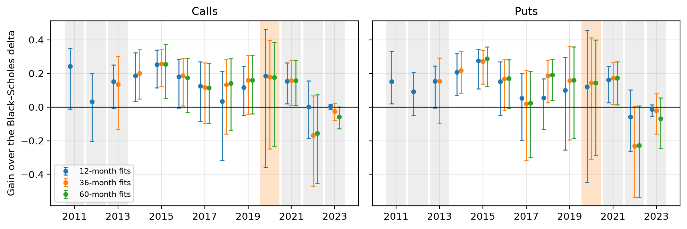

# Does Hull and White’s minimum-variance delta hedge SPX options better? A pre-registered model validation, 2011–2023

## Bottom line

Does adjusting the Black–Scholes delta for changing volatility improve daily SPX option hedges? A dealer hedges each option by holding delta units of the index. The Black–Scholes delta treats volatility as fixed, although implied volatility—the volatility consistent with an option’s price—tends to rise when the index falls. Hull and White’s minimum-variance delta corrects for this response, using monthly regressions on past prices. Its Gain is the fraction of the Black–Scholes delta’s squared one-day hedging error that it removes.

**The pre-registered SPX 2020 test is inconclusive.** The minimum-variance delta removed 18.5% of the squared error for calls and 12.0% for puts. But the March 2020 crash leaves 95% intervals spanning about −0.4 to +0.46, so neither an improvement nor a loss is established. The verdict rule was committed before any 2020 hedging outcome was computed. All 11 pre-specified robustness variants preserve the verdict, though wide intervals limit what that agreement establishes.

Repeated out of sample over 2011–2023, with monthly fits on the preceding 12 months, the correction usually helps. Its median yearly Gain over 2015–2023, the span common to all fitting windows, is 0.12 for calls and 0.10 for puts. In no year is it significantly worse than Black–Scholes. Its advantage disappears in 2022–2023, as implied volatility became less responsive to index moves.

Simpler rules do almost as well. One fitted constant correction gives essentially the same Gain as the three-coefficient form. Machine-learning corrections add no material improvement, and two fail badly in the crash. Ruf and Wang’s fixed 0.9/1.1 scaling, an unfitted rule of thumb read off their results, matches the minimum-variance delta’s median Gain but fails in 2022–2023.

*Figure 1. Yearly Gain of the minimum-variance delta over the Black–Scholes delta, SPX, 2011–2023, calls and puts, with 12-, 36- and 60-month fits and 95% session-block bootstrap intervals. Grey: the clean held-out years (2011–2013, 2021–2023). Orange: the pre-registered test year, 2020.*

## 1. The problem

We replace the standard Black–Scholes delta with alternative hedge ratios, mainly Hull and White’s minimum-variance delta, the right-hand side of their equation (2):

$$
\delta_{\mathrm{MV}}\approx\delta_{\mathrm{BS}}
+\nu_{\mathrm{BS}}\frac{\partial E[\sigma_{\mathrm{imp}}]}{\partial S}.
$$

Here $S$ is the index level and $\sigma_{\mathrm{imp}}$ is implied volatility. Vega, $\nu_{\mathrm{BS}}$, measures the option price’s sensitivity to volatility. The correction hedges the expected volatility response to an index move.

The main rules, simplest first, are four:
1. the Black–Scholes delta, the benchmark;
2. the fixed 0.9/1.1 scaling: 0.9 times delta for calls, 1.1 times delta for puts;
3. the fitted scaling, $a\delta$, with $a$ fitted monthly;
4. the minimum-variance delta, with three coefficients fitted monthly.

The exploratory challengers are a constant correction; polynomials in delta of degrees 0–8, and a separate rule whose degree is selected by validation; a relaxed Hull–White rule with a free delta multiplier; Ruf and Wang’s delta–vega–vanna regression; and LightGBM corrections using delta alone or market features.

The question matters to dealers who hedge daily, and to the teams that validate their models. Black–Scholes leaves the volatility response unhedged. Hull and White read the evidence as favouring volatility feedback (higher volatility raises required returns and lowers prices) over leverage as its cause.

## 2. Data

OptionsDX supplies end-of-day SPX and SPY quotes for 2010–2023, and AAPL, NVDA, TSLA, QQQ and SLV quotes for 2016–2023. Underlying levels come from FRED for the S&P 500 (Cboe before 2016-10), from Nasdaq for SPY (Stooq before 2016-11), and from vendor snapshots for the five stocks and ETFs. Dividends come from SSGA for SPY and from Nasdaq for AAPL, NVDA and QQQ.

Each observation pairs one contract at consecutive closes: 1.06 million pairs in SPX 2020, and about 7.6 million over 2011–2023. The sample requires at least 14 days to expiry, an absolute delta of 0.05–0.95, and trading on day one. Data handling is documented in the README and `DATA.md`.

## 3. Methodology

Hull and White’s equation (5) specifies the fitted rule:

$$
\delta_{\mathrm{MV}}=\delta_{\mathrm{BS}}
+\frac{\nu_{\mathrm{BS}}}{S\sqrt{T}}
\left(a+b\delta_{\mathrm{BS}}+c\delta_{\mathrm{BS}}^2\right).
$$

Here $T$ is the time to expiry in years. The $1/S$ factor makes volatility respond to index returns rather than to point moves. The $1/\sqrt{T}$ factor is Hull and White’s empirical maturity scaling. The quadratic lets the correction vary across strikes. Least squares fits the coefficients separately for calls and puts.

For a hedge ratio $h$, the error is $e=(\Delta f-h\Delta S)/S$, where $\Delta f$ is the option’s price change. The Gain is $1-\mathrm{SSE}(\mathrm{rule})/\mathrm{SSE}(\mathrm{Black\text{–}Scholes})$, using sums of squared errors on identical pairs. A Gain of 0.10 means 10% less squared error, or about 5% lower root-mean-square (RMS) error.

Monthly fits use trailing 12-month windows, with 36- and 60-month alternatives. Each fit hedges only the following month, and training pairs must end before the test month starts. Before 2020 was opened, a rehearsal on 2018–2019 and a dry run of the test script on 2019 checked the code and the model’s form.

The walk-forward repeats this chronological protocol over 2011–2023. Its untouched years, 2011–2013 and 2021–2023, are the clean held-out evidence. Bootstrap intervals resample trading days rather than options, because options share each day’s index move. Yearly and episode significance is pointwise and not adjusted for multiple comparisons.

The exploratory analyses are all descriptive, and most were specified after 2020 had been seen. They cover the additional rules, an SPY replication, parameter stability, the polynomial degree and the maturity scaling, the correction’s level and shape, the published benchmarks, books, 5- and 10-day held positions, reduced training data, short-dated options, and five stocks and ETFs. Stress episodes are defined from the S&P 500 close alone: 20-day realized volatility above 25%, or a peak-to-trough drawdown of at least 10%. Episode Gains use the walk-forward’s fits, and stress and calm sessions are compared by year.

## 4. Principal findings

### 4.1 The confirmatory test

The pre-registered verdict for 2020 is Inconclusive: neither option type’s 95% lower bound is above zero (table below). The minimum-variance delta is not distinguished from either scaling rule.

For perspective, the Black–Scholes delta alone removes 92–95% of the unhedged squared error. The minimum-variance delta lowers the calls’ RMS error per contract from \$825 to \$727. The stress period, 24 February to 30 April, contains 80–86% of the year’s squared error, and ten sessions contain 65–73%. Given these interval widths, only a Gain above roughly 0.5 could have cleared zero.

| Hedge rule | Coefficients fitted | SPX 2020, calls | SPX 2020, puts | Median yearly Gain 2015–2023, calls / puts (12-month fits) |
|---|---|---|---|---|
| Fixed 0.9/1.1 scaling (Ruf and Wang's rule of thumb) | 0 | 0.181 [−0.13, 0.34] | 0.021 [−0.30, 0.23] | 0.125 / 0.099 |
| Fitted scaling $a\cdot\delta$ | 1 | 0.151 [−0.32, 0.36] | −0.076 [−0.52, 0.22] | 0.120 / 0.060 |
| Constant correction | 1 | 0.190 [−0.32, 0.46] | 0.120 [−0.44, 0.46] | 0.119 / 0.105 |
| Minimum-variance delta (Hull and White) | 3 | 0.185 [−0.36, 0.46] | 0.120 [−0.45, 0.46] | 0.124 / 0.100 |

Gains are over the Black–Scholes delta. Brackets are 95% session-block bootstrap intervals. The constant correction’s 2020 values come from the walk-forward, which uses the same 12-month fits as the 2020 test.

### 4.2 Years and stress episodes

Yearly Gains are mostly 0.10–0.25 through 2021, and about zero in 2022–2023. With 12-month fits, the Gain is significantly positive in 7 of 26 call-or-put years and significantly negative in none.

Sell-offs gain significantly in 2011, 2015–2016 and February 2018. September–December 2022 loses significantly: −0.52 for calls and −0.56 for puts. SPY replicates the picture: 2020 is inconclusive, and puts typically gain 16–28% a year through 2021.

### 4.3 Complex against simple rules

The minimum-variance delta beats the fixed scaling significantly in 14 of 26 call-or-put years, and loses in two, both in 2018. The fitted scaling is significantly worse in 12 of 26, and never significantly better.

For SPX with 12-month fits, the constant correction, every polynomial degree and the delta-only LightGBM correction all stay within about 0.015 a year of the minimum-variance delta. Ruf and Wang’s delta–vega–vanna regression is slightly worse: median Gains of −0.011 / −0.004 relative to it, and −0.18 for 2020 puts.

The LightGBM corrections that use market features fail. In 2020 their squared error for puts was 9–11 times Black–Scholes’, after the crash took their features outside the training range.

### 4.4 The level and assumption checks

The level replaces the quadratic with one constant: the hedge’s assumed sensitivity of implied volatility to the index. A level of −0.13 means a 1% index fall raises implied volatility by 0.13 volatility points at one year to expiry, or 0.26 at three months. The fitted quadratic, averaged over the training options with the regression’s weights, equals this constant exactly.

The level supplies the Gain; variation across strikes adds only −0.014 to +0.015 a year. The individual coefficients are poorly identified, but the level is well identified.

The level varies over time. Fits 12 months apart differ by more than two reported standard errors in 19% of call and 10% of put comparisons. These standard errors omit serial dependence across sessions, so the counts may overstate the instability; the effect is not quantified.

With 12-month fits, degrees 0–8 give essentially the same Gain. Maturity powers $T^{-\alpha}$ for $\alpha=0,0.25,0.75,1$ never consistently beat $1/\sqrt{T}$.

### 4.5 Extensions and published benchmarks

**Books.** We score each day’s average error across all calls, all puts, or long-volatility positions in out-of-the-money options; a risk reversal is the control. For SPX calls, the median yearly Gain over 2011–2023 is 0.22 on the book against 0.15 per option, about 1.4 times. Losses grow too, and the control gains little. Only a book’s total correction matters, so on books the fixed scaling roughly ties the minimum-variance delta.

**Held positions.** These tests accumulate the error over 5 or 10 days, rehedging daily. In 2011–2019 the Gain rises from 12–13% one day at a time to 19–20% over 5 days on the same pairs; on the 10-day paths it rises from 12–15% to 24–34%. Losses also grow, in 2021–2023.

**Data starvation.** These tests keep fewer options per training day, or shorten the training window. Three options of each type a day cost only about 0.01 in Gain. Windows below three months lose 0.02–0.07 a year. Yet a three-month window would have adapted to 2022: puts go from −0.058 to +0.047.

Among the stocks and ETFs, AAPL gains a little; NVDA, TSLA and SLV gain nothing or lose; and QQQ behaves like SPX. Options under 14 days gain 0.06 / 0.005 for calls / puts, and about zero under three days. Our pooled 2013–2015 Gains with 36-month fits are 0.22 / 0.25, while Hull and White report mean monthly Gains of 0.26 / 0.23 over 2007–2015. Our lower headline reflects the period, the 12-month window and in-the-money calls, the last of these the least.

## 5. Financial interpretation

The correction hedges the expected volatility response. About 70% of an option’s squared error is shared by all options on the day and survives averaging across a book, which explains the larger book Gain. The size of the response matters more than its shape across strikes. For near-the-money options 20–60 days from expiry, the measured response fell from 0.55 volatility points per 1% index fall in 2021 to 0.13 in 2022–2023, and the Gain fell with it.

**Drift.** For one-day hedges, we follow Hull and White’s specification, with no intercept and no theta adjustment. Subtracting one day’s theta changes the 2020 Gains by at most 0.011.

For the long-option position that $e$ represents, the correction leaves the position slightly longer the index, because it under-hedges calls and over-hedges puts. Its five-day mean error exceeds Black–Scholes’ by about 0.9 basis points of the index level in 2011–2019. That is consistent with earning some of the index’s upward drift, and the difference is not significant.

If the mean P&L is unchanged, and the reduction in squared error approximates the reduction in variance, a Gain $g$ multiplies the hedged position’s Sharpe ratio by about $1/\sqrt{1-g}$: 1.08 at $g=0.15$.

**Where it works and fails.** Here the slope is the number of volatility points by which implied volatility rises per 1% fall in the index.
- **Works:** index options; sell-offs; years in which the slope stays close to the preceding year’s; books and held positions.
- **Fails:** after a crash enters the training window (April 2020); in rebounds and post-crash periods (late 2018, losses not significant; late 2022, significant); when the slope weakens (2022–2023); on single stocks and silver; near expiry.

## 6. Assumptions, limitations and failure modes

| Assumption | Check | Result |
|---|---|---|
| Volatility response is quadratic in delta | Degrees 0–8, a validated degree, LightGBM on delta | Small economic differences; some pointwise significant improvements |
| Response scales as $1/\sqrt{T}$ | $T^{-\alpha}$, $\alpha\in\{0,0.25,0.75,1\}$, by year | Not beaten consistently |
| Coefficients remain stable between windows | Coefficient paths; fits 12 months apart | Fails: the level drifts, badly in 2022 |
| No intercept or theta term is needed | Theta-adjusted 2020 variant; held-position mean error | 2020 Gains change by at most 0.011 with theta adjustment; five-day mean-error difference from Black–Scholes about +0.9 bp in 2011–2019, not significant |
| One day is the relevant horizon | 5- and 10-day held positions | Gain grows in 2011–2019 and 2020; losses can grow too |
| Mid quotes are synchronous with the index | Two index-level sensitivities; bid and ask marks | Verdict unchanged |
| Frictionless index hedging | Turnover only | Not tested with costs |

There is one confirmatory year, and it contains a crash. The other analyses are exploratory, and clean years are few. The study uses one data vendor and excludes transaction and financing costs. The intervals omit the training window’s estimation error, and a crash strains the bootstrap’s assumptions. SPY’s held-position test follows a contract only through days on which it traded with at least 14 days to expiry, and the five stocks and ETFs use the vendor’s underlying levels.

The observed failure modes are:
- a crash entering the training window, followed by over-correction: April 2020, and the stocks’ 2020;
- the LightGBM corrections with market features extrapolating outside their training range in March 2020;
- a fixed scaling of delta applied outside the market and period it was read from. Ruf and Wang’s 0.9/1.1 comes from S&P 500 options from 2010 to mid-2019. It fails on SPY calls and single stocks, and on SPX itself in 2022–2023, as the volatility response weakened.

## 7. Reproducibility

The repository is [github.com/biswajit-nag/hull-white-delta-spx](https://github.com/biswajit-nag/hull-white-delta-spx). Run `uv sync`, then the scripts in `scripts/` and the numbered notebooks, which are committed with outputs. `results/runtime_log.csv` records each run’s commit and wall time.

This is an individual project. Claude (Anthropic) assisted with code, analysis and drafting. GPT-6 Astra (OpenAI) reviewed key steps and helped in wording the reports. The author directed the work and takes the responsibility for its correctness.

## References

- Hull, J. and White, A. (2017). Optimal delta hedging for options. *Journal of Banking & Finance* 82, 180–190.
- Ruf, J. and Wang, W. (2022). Hedging with linear regressions and neural networks. *Journal of Business & Economic Statistics* 40(4), 1442–1454.
- OptionsDX. End-of-day option chains (data).
- Erdős Institute Quantitative Finance Boot Camp, Fall 2026. Lecture 12 option-pricing library.
