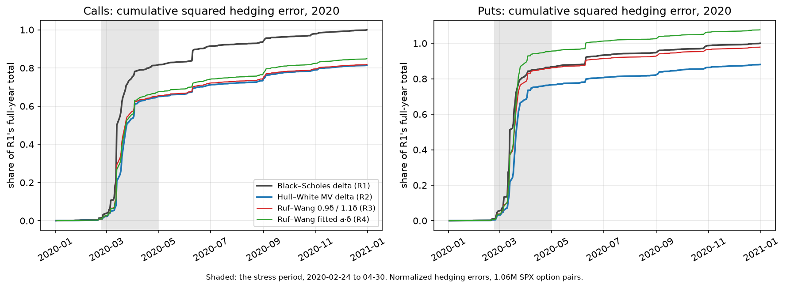
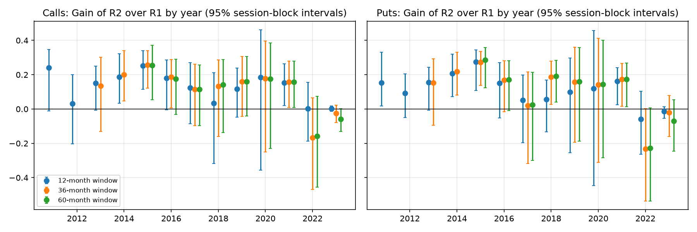

# Does Hull and White's minimum-variance delta hedge SPX options better? A pre-registered test on 2020

**Verdict: Inconclusive.** On 1.06 million SPX option-days in 2020, Hull and White's (2017) minimum-variance delta cut next-session squared hedging error by 18.5% for calls and 12.0% for puts, relative to the Black–Scholes delta. Hull and White found about 26% and 23% for 2007–2015, averaging monthly Gains. But 2020 contains the March crash: a handful of sessions decide the year, and the 95% confidence intervals are [−0.36, 0.46] and [−0.45, 0.46]. So the improvement is not established, and neither is its absence.
- **The two scaling rules.** Against Ruf and Wang's (2022) simpler rules, the fixed 0.9·δ for calls and 1.1·δ for puts, and a fitted a·δ, the minimum-variance delta is *not distinguished*.
- **The verdict is robust.** Every pre-specified robustness variant gives the same verdict: the index level, the training window, the price marks, the spread screen, the vanished quotes, and leaving out the crash.



*Cumulative squared hedging error through 2020, as a share of the Black–Scholes delta's full-year total. Most of each year's error arrives in the shaded stress period, 2020-02-24 to 04-30.*

**What 2020 shows beyond the verdict:**
- **Concentration.** The stress period holds 80% (calls) and 86% (puts) of the year's Black–Scholes squared error, and ten sessions hold 65–73%. The pooled Gain is essentially a March 2020 number.
- **Instability.** Month by month the Gain swings from about +0.4 to −0.8, and **the average of the monthly Gains is about zero** for both calls and puts. The fitted coefficients absorbed the crash in April, when the market had calmed, and over-corrected. In April, August, September and November even a fit to that month's own data removed almost nothing (0–8%): the spot–volatility relation the rule relies on had all but vanished.
- **A flexible challenger failed in the crash.** A gradient-boosted correction tuned on calm 2019 data met features far outside its training range in March 2020 and over-hedged puts badly.

## The question

When an option dealer delta-hedges with the underlying, should it use the Black–Scholes delta, or a delta corrected for the fact that implied volatility tends to fall when the index rises?

**Hull and White's answer.** They estimate the expected change in implied volatility per index move from historical data, and fold it into a *minimum-variance* delta,

  δ_MV = δ_BS + ν_BS/(S·√T)·(a + b·δ_BS + c·δ_BS²),

with a, b, c fitted monthly by regression. Over 2007–2015 they found it removed 23–26% more of the squared hedging error than the Black–Scholes delta.

**Ruf and Wang's simplification.** They found most of that gain from simply scaling the Black–Scholes delta: 0.9·δ for calls, 1.1·δ for puts.

**This project** tests both out of sample, on a stress year, under a plan committed before any test-year number was computed. That makes it a model-validation exercise in the sense of the instructor's brief: where does the model work, where does it fail, and is it better than a simpler alternative?

## Data

OptionsDX end-of-day quotes for SPX index options (European, cash-settled), 2010–2023; the analysis uses 2015–2020 and the extension 2010–2023.
- **A hedge observation is a pair:** one contract at one session's close and the same contract at the next NYSE session's close. That is 1.06M pairs in 2020.
- **The sample.** Following Hull and White: at least 14 days to expiry and 0.05 ≤ |δ| ≤ 0.95, with a positive day-one volume (Ruf and Wang).
- **The index level** is the official S&P 500 close (FRED; Cboe before 2016-10).

The audit found and handled several vendor problems; `DATA.md` records every rule:
- an April 2019 window of shifted expiry stamps, excluded;
- option quotes synchronous with neither index series (median gap 3.3 bp), handled with two sensitivities;
- **a volume field that leaves days with 1,000 or more contracts blank through 2021.** Rows with empty volume and a positive last price are exactly the heavily traded ones, and they vanish when the vendor starts recording volumes of 1,000 or more in 2022. Treating every empty field as "no trade", as a naive volume filter would, drops the busiest contracts.

## Method

The full specification is [`analysis_plan.md`](analysis_plan.md). It was reviewed jointly by two AI models, Claude and GPT-6 Astra, and committed (77b030e) before any hedging outcome was computed.
- **Forwards, not dividend yields.** Each expiry's forward and discount factor come from put–call parity at the mids, so no rate or dividend yield is assumed. Implied volatilities come from the boot camp's Lecture 12 solver; Greeks are Black–Scholes at each option's own implied volatility.
- **The rules,** all on Hull and White's normalized scale:
  - R1, Black–Scholes;
  - R2, Hull–White;
  - R3, Ruf–Wang fixed;
  - R4, Ruf–Wang fitted;
  - plus exploratory challengers, including LightGBM corrections.
- **Chronological fitting.** Each 2020 month is hedged with coefficients fitted on the 12 months before it, and a training pair must end before the test month starts.
- **The measure.** Gain = 1 − Σe²(rule)/Σe²(Black–Scholes) on identical pairs.
- **Inference by session, not by option.** Every option on a day shares that day's index move, so naive OLS standard errors are 4.5–34 times too small here. Intervals come from a circular block bootstrap of sessions (B = 10,000).
- **The verdict table and its thresholds** ("material" means a Gain of at least 0.05) were fixed in advance.
- **Before 2020 was opened,** a rehearsal on 2018–2019 checked the code and the model's form: 1/√T is not contradicted, and a cubic in δ is no better in any useful sense. A full dry run on 2019 checked the test script.

## Results (2020)

| Comparison | Calls: Gain [95% CI] | Puts: Gain [95% CI] |
|---|---|---|
| Hull–White over Black–Scholes (H1) | 0.185 [−0.357, 0.463] | 0.120 [−0.447, 0.457] |
| Hull–White over the fixed 0.9δ / 1.1δ | 0.005 [−0.207, 0.185] | 0.101 [−0.112, 0.303] |
| Hull–White over the fitted a·δ | 0.040 [−0.074, 0.163] | 0.182 [−0.080, 0.319] |
| Black–Scholes over no hedge (effectiveness) | 0.918 [0.871, 0.964] | 0.947 [0.932, 0.959] |

**Reading the table:**
- **Black–Scholes does most of the work,** removing 92–95% of the unhedged variance. The minimum-variance correction works on what is left.
- **In dollars,** it cut the RMS hedging error per contract from about $825 to $727 for calls in 2020.
- **The details** are in [`notebooks/04_results_2020.ipynb`](notebooks/04_results_2020.ipynb) (the verdict, its robustness, the monthly path and the coefficient paths) and [`notebooks/05_breakdown_and_sensitivities.ipynb`](notebooks/05_breakdown_and_sensitivities.ipynb) (buckets, sensitivities, the attribution, the gradient-boosted challenger and SPY).

## Stability across years

The question also asks how stable the advantage is across years. The pre-declared walk-forward (`analysis_plan.md` §14) answers it: monthly refits on 12-, 36- and 60-month windows, every month from 2011 (12-month window), 2013 (36) and 2015 (60) to 2023.



- **2011–2021: a consistent advantage.** With the 12-month window, the Gain over Black–Scholes is positive in every year, mostly 0.10–0.25. That is Hull and White's result, roughly, out of sample. The median yearly Gain over 2015–2023 is 0.12 (calls) and 0.10 (puts).
- **2021, a year nobody had looked at,** is clean evidence for the rule. It beats Black–Scholes (calls 0.154 [0.020, 0.264], puts 0.161 [0.025, 0.242]) and also the fitted scaling rule.
- **2022–2023: the advantage disappears.** With the 12-month window the Gain is about 0, with tight intervals in 2023 (calls [−0.014, 0.017]). With the 36- and 60-month windows it is negative in 2022 (about −0.16 to −0.23), and for puts R2 is significantly worse than the fitted scaling rule (−0.21 [−0.33, −0.10]).
- **Why: the spot–volatility relation weakened.** Near the money, implied volatility rose 0.13 vol points per 1% index fall in both 2022 and 2023, against 0.25–0.55 in 2011–2021 (`scripts/spot_vol_slope.py`). The correction learned from history was too large, and rules fitted on longer histories paid more for it. 2017, the earlier low-slope year (0.20), also had the smallest earlier Gains. This reading is descriptive, not a pre-specified test.

The years' status matters: 2015–2020 had been used for fitting or evaluation before the walk-forward, so only 2011–2013 and 2021–2023 are clean held-out years (`results/year_ledger.csv`).

## Extensions

- **SPY** (American options, quarterly dividends; Lecture 12's American pricer). The same picture: point Gains of 0.10 (calls) and 0.25 (puts), intervals spanning zero.
- **A machine-learning challenger.** Gradient boosting tuned on 2019 failed for puts in March 2020, when its features left the range it was trained on.

## What this does not establish

- **Executable hedge performance.** The hedge is the index itself, frictionless, at closing prices; there are no transaction, financing or basis costs.
- **Generalization from one year.** One test year, containing a crash, cannot settle a 20% effect. The walk-forward adds years, and shows the effect is not stable: present through 2021, absent in 2022–2023.
- **The data.** One vendor; quotes of undocumented timing; results conditional on a usable next-session quote (98.7% of eligible pairs in 2020; the rest are almost all sessions the vendor lacks).
- **The model's assumptions.** A diffusion with a stable spot–volatility relation. 2020 broke the second.

## Reproducing

```
uv sync
uv run python -I scripts/build_interim.py
uv run python -I scripts/build_processed.py --underlying spx --years 2010-2023
uv run python -I scripts/build_greeks.py 2010 2023
uv run python -I scripts/build_pairs.py 2010 2023
uv run pytest
uv run python -I scripts/run_rehearsal.py
uv run python -I scripts/tune_r8.py 2019
uv run python -I scripts/run_test_year.py 2020 <plan-commit>
uv run python -I scripts/run_walkforward.py
uv run python scripts/make_notebooks.py
```

**What you need first:** the vendor archives and external files, and a clone of the boot camp's lecture repository for `option_pricing.py` (set `ERDOS_LECTURE12`); see `DATA.md`.

**The record.** `results/runtime_log.csv` records every run, with its commit and wall time. `results/year_ledger.csv` records which years' outcomes were seen, and when.

## Repository

| Path | Contents |
|---|---|
| `analysis_plan.md` | The pre-registered plan, its deviation log (§15) and extension specifications (§16) |
| `DATA.md` | Data sources and every processing rule |
| `src/erdos_quant_finance_project/` | The package: parsing, parity, Black–Scholes, pairs, hedging, diagnostics, learners, verdict |
| `scripts/` | Pipeline steps and experiments, each with usage in its header |
| `tests/` | pytest checks: Greeks against finite differences and the lecture library, parity recovery, known coefficients, no look-ahead, the bootstrap, the verdict table |
| `notebooks/` | 01 audit and attrition · 02 forwards, IVs, Greeks · 03 rehearsal · 04 the 2020 results · 05 breakdown and sensitivities · 06 the 2011–2023 walk-forward · 07 SPY · 08 more rules and short-dated options · 09 stress, stability and interpretation · 10 books, data starvation, held positions · 11 single stocks and ETFs |
| `EXECUTIVE_SUMMARY.md` | The executive summary |
| `results/` | Derived tables and figures; per-pair files are regenerable and not committed |

## References

- Hull, J., White, A. (2017). Optimal delta hedging for options. *Journal of Banking & Finance* 82, 180–190.
- Ruf, J., Wang, W. (2022). Hedging with linear regressions and neural networks. *Journal of Business & Economic Statistics* 40(4), 1442–1454.

**Use of AI tools.** Code, analysis and documentation were developed with Claude (Anthropic), and the analysis plan was reviewed jointly with GPT-6 Astra (OpenAI). The author is responsible for the methodology, its validation and its interpretation.
